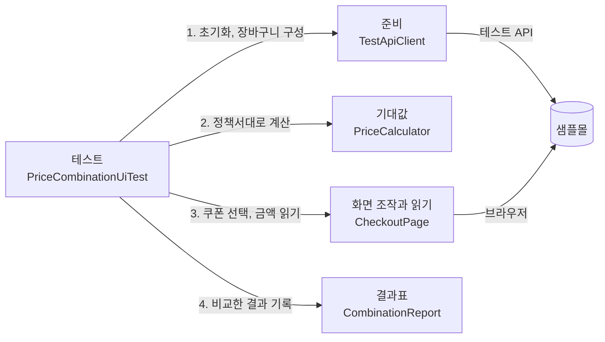

# 결제 금액 조합 테스트 자동화

쇼핑몰 주문서의 결제 금액이 정책서대로 나오는지, 조합 300개를 화면에서 자동으로 확인하는 도구입니다.

| 항목 | 내용 |
|---|---|
| 대상 | 연습용 쇼핑몰(샘플몰)의 주문서 화면 |
| 범위 | 회원 등급 2 × 장바구니 30 × 쿠폰 5 = 조합 300개 |
| 확인하는 값 | 조합마다 쿠폰 할인 · 배송비 · 최종 결제 금액 |
| 도구 | Java 17 · Playwright · JUnit 6 · Maven |
| 결과 | 300개를 약 1분에 확인, 정책서와 다른 조합 15개 → 결함 2건 |

## 왜 만들었나

커머스 서비스 QA 실무에서 결제 화면의 포인트 · 쿠폰 · 결제 수단 조합을 손으로 검증했습니다. 결제 화면이 바뀌면 같은 확인을 처음부터 다시 했습니다.

결제 금액은 드물게 틀려도 돈이 틀리는 문제라 바뀔 때마다 봐야 합니다. 그런데 손으로는 고른 조합만 볼 수 있습니다.

같은 모양의 문제를, 직접 통제할 수 있는 연습용 서비스에서 자동화로 풀어 본 프로젝트입니다.

## 무엇을 테스트하나

결제 금액은 네 단계로 정해집니다.

1. 상품금액 = 단가 × 수량의 합
2. 쿠폰 할인 (최소 주문금액, 카테고리, 정률 내림, 최대 할인액)
3. 배송비 = **할인 후** 상품금액이 등급 기준(일반 30,000원 · VIP 20,000원) 이상이면 0원, 아니면 3,000원
4. 최종 결제 금액 = 할인 후 상품금액 + 배송비

3번 때문에 조합이 늘어납니다. 쿠폰이 금액을 바꾸고, 바뀐 금액이 배송비를 다시 정합니다. 같은 32,000원 장바구니가 쿠폰에 따라 무료배송이었다가 배송비 3,000원이 붙습니다.

그래서 금액과 쿠폰을 짝지어 봐야 하고, 경계가 되는 금액도 쿠폰마다 달라집니다. 이렇게 모은 장바구니가 30가지이고, 쿠폰 5가지(없음 포함)와 등급 2가지를 곱해 300개가 됩니다.

| 구분 | 조합 수 | 고른 기준 |
|---|---|---|
| 손으로 수행하는 TC | 77개 | 쿠폰마다 그 쿠폰의 규칙이 바뀌는 금액만 |
| 자동화 | 300개 | 전부 |

자세한 과정은 [조합 300개가 나온 과정](docs/test-design.md)에 있습니다.

## 결과

| 실행 범위 | 조합 | 걸린 시간 | 정책서와 다른 조합 |
|---|---|---|---|
| 손으로 수행하도록 고른 조합 | 77개 | 17초 | 15개 |
| 전체 | 300개 | 55~58초 (3회 실행) | 15개 |

걸린 시간은 준비(초기화, 장바구니 구성)부터 화면 조작, 비교, 기록까지입니다. 세 번 실행해서 300개 결과가 모두 같았습니다.

**정책서와 다른 조합 15개는 원인이 두 가지였습니다.**

- **결함 1** — 할인 후 상품금액이 무료배송 기준과 딱 같을 때 배송비 3,000원이 붙음 (조합 11개)
- **결함 2** — 의류와 다른 카테고리를 함께 담으면 합계가 30,000원 이상이어도 '의류 10% 할인'을 고를 수 없음 (조합 4개)

재현 절차와 증거는 [결함 리포트](docs/defects.md)에, 조합별 결과는 [결과표](docs/results/price-combinations-all.md)에 있습니다.

**15개는 모두 손으로 고른 77개 안에 있었습니다.** 나머지 223개에서 새로 나온 결함은 없습니다.

경계값으로 고른 77개가 제 역할을 했다는 뜻입니다. 그래서 이 자동화의 값은 결함을 더 찾는 데 있지 않습니다. 믿고 넘어가던 223개를 실제로 확인했다는 것, 그리고 쿠폰이나 정책이 바뀔 때마다 300개 전체를 1분에 다시 확인할 수 있다는 데 있습니다.

## 구조

테스트 한 건은 네 부품을 차례로 씁니다.



```text
src/main/java/samplemall
├── config/TestConfig          실행 옵션 (서버 주소, 실행 범위 등)
├── policy/                    정책서를 코드로 옮긴 것
│   ├── PriceCalculator        기대값 계산기
│   └── Grade, Coupon, Cart …  등급, 쿠폰, 장바구니
├── api/TestApiClient          테스트 API 호출 (초기화, 장바구니 구성)
└── page/CheckoutPage          주문서 화면 (Page Object)

src/test/java/samplemall
├── PriceCalculatorTest        계산기 검증 (서버 없이 실행)
├── SmallPartsTest             작은 부품 검증 (서버 없이 실행)
├── PolicyExampleUiTest        정책서 예시 6개를 화면에서 확인
├── PriceCombinationUiTest     조합 300개를 화면에서 확인
└── support/                   데이터 읽기, 브라우저 준비, 결과표

src/test/resources/price-combinations.csv   조합 300줄 (테스트 데이터)
```

부품을 나눈 기준은 "무엇이 바뀌면 어디를 고치나"입니다. 정책이 바뀌면 `policy/`, 화면이 바뀌면 `page/`, 조합을 늘리려면 CSV만 고칩니다. 자세한 설명과 코드 읽는 순서는 [구조와 코드 읽는 순서](docs/architecture.md)에 있습니다.

## 설계하면서 정한 것

- **준비는 API로, 확인은 화면으로** — 장바구니 같은 사전 상태는 테스트 API로 빠르게 만들고, 사용자가 보는 값은 화면에서 읽습니다.
- **기대값 계산기부터 검증** — 계산기는 정책서만 보고 만들었습니다. 화면을 보기 전에 정책서 예시 6개, TC 문서의 기대값 300개와 같은 값을 내는지 먼저 확인합니다.
- **고정 대기 없이 응답을 기다림** — "0.5초 쉬기" 대신, 화면이 서버 응답을 받아 다시 그려질 때까지 기다린 뒤 읽습니다.
- **서버 시각 고정** — 쿠폰에 사용 기간이 있어서, 테스트마다 서버 시각을 기준 날짜로 고정합니다. 날짜가 지나도 같은 결과가 나옵니다.
- **테스트끼리 기대지 않음** — 테스트마다 서버를 초기화하고 브라우저 창을 새로 엽니다.
- **정답이 없는 값은 판정하지 않음** — 정책서 두 곳이 서로 다른 값(적립 예정 포인트 등)은 자동 판정에서 빼고 정책 문의로 남겼습니다.

## 실행 방법

JDK 17 이상과 Maven이 필요합니다. 대상 서비스(샘플몰)는 이 저장소에 들어 있지 않습니다. 결함을 일부러 심어 둔 연습용 서비스라 테스트 코드와 따로 둡니다.

```bash
# 처음 한 번: 테스트용 브라우저(크로미움) 내려받기
mvn exec:java -e -D exec.mainClass=com.microsoft.playwright.CLI -D exec.args="install chromium"

# 계산기와 부품 검증 (서버 없이 실행, 1초)
mvn test -Dtest='PriceCalculatorTest,SmallPartsTest'

# 전체 실행 (샘플몰 서버가 켜져 있어야 합니다)
mvn test

# 손으로 수행하도록 고른 77개만
mvn test -Dtest=PriceCombinationUiTest -Dscope=manual77

# 브라우저 창을 띄워 눈으로 보면서
mvn test -Dtest=PolicyExampleUiTest -Dheadless=false -Dslowmo=300
```

| 옵션 | 기본값 | 뜻 |
|---|---|---|
| `-Dmall.url` | `http://localhost:8000` | 샘플몰 서버 주소 |
| `-Dscope` | `all` | `all` = 300개, `manual77` = 손으로 수행하도록 고른 77개 |
| `-Dheadless` | `true` | `false`면 브라우저 창이 보임 |
| `-Dslowmo` | `0` | 동작 사이 지연(밀리초) |

실행이 끝나면 `target/reports/`에 결과표가, 실패한 조합은 `target/screenshots/`에 화면 그림이 남습니다. 결함이 있는 대상을 테스트하므로 `mvn test`는 실패(빨간불)로 끝나는 것이 정상입니다.

## 한계

- 결제 금액 상자의 세 값만 봅니다. 결제 처리, 취소, 중복 요청은 [TC 문서](docs/testcases)에는 있지만 자동화 범위 밖입니다.
- 서버 상태를 함께 쓰기 때문에 테스트를 하나씩 차례로 실행합니다.
- 브라우저 1종(크로미움)에서만 실행합니다. 실제 단말에서만 나오는 화면 문제는 손으로 봐야 합니다.

## AI 활용

TC 초안과 자동화 코드 작성에 AI 코딩 도구(Claude Code)를 사용했습니다. 테스트 대상과 범위는 실무 경험을 바탕으로 직접 정했습니다.
