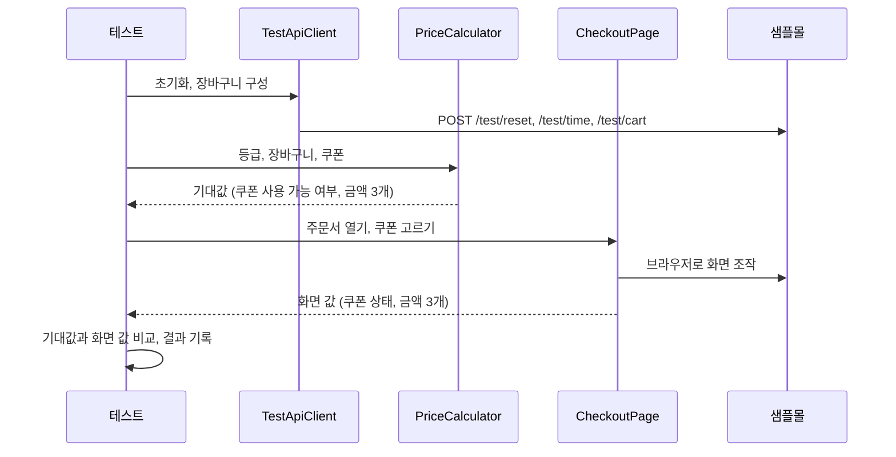
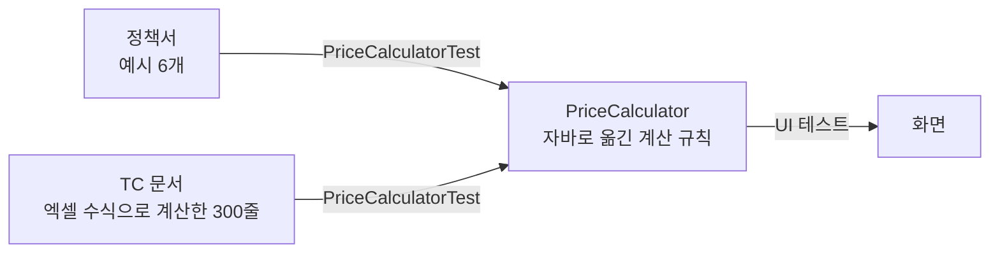

# 구조와 코드 읽는 순서

## 테스트 한 건이 하는 일

조합 하나를 확인할 때 손으로 하는 일과 코드가 하는 일은 같은 순서입니다.

| 손으로 할 때 | 코드 | 맡은 부품 |
|---|---|---|
| 셋팅 명령을 터미널에 붙여 넣는다 | 초기화하고 장바구니를 만든다 | `TestApiClient` |
| TC의 기대 결과 칸을 읽는다 | 정책서대로 기대값을 계산한다 | `PriceCalculator` |
| 새로고침하고 쿠폰을 고른다 | 주문서를 열고 쿠폰을 고른다 | `CheckoutPage` |
| 화면 숫자를 기대 결과와 비교한다 | 기대값과 화면 값을 비교한다 | 테스트 (`assertEquals`) |
| 결과 칸에 Pass/Fail을 적는다 | 결과표에 한 줄 적는다 | `CombinationReport` |

## 부품을 나눈 기준

"무엇이 바뀌면 어디를 고치나"로 나눴습니다. 바뀌는 이유가 다른 코드를 한 파일에 섞으면, 하나를 고칠 때 다른 것까지 건드리게 됩니다.

| 바뀌는 것 | 고칠 곳 | 안 고쳐도 되는 곳 |
|---|---|---|
| 정책 (무료배송 기준, 쿠폰 조건) | `policy/` | 화면, 테스트 |
| 화면 (버튼 위치, 요소 이름) | `page/CheckoutPage` | 정책, 테스트 |
| 준비 방법 (테스트 API) | `api/TestApiClient` | 정책, 화면, 테스트 |
| 확인할 조합 | `price-combinations.csv` | 코드 전체 |

## 파일마다 하는 일

### 테스트를 돕는 부품 (`src/main/java/samplemall`)

| 파일 | 하는 일 |
|---|---|
| `config/TestConfig` | 서버 주소, 실행 범위처럼 실행할 때 바꾸는 값을 한곳에서 읽는다 |
| `policy/Grade` | 회원 등급과 무료배송 기준 |
| `policy/Coupon` | 쿠폰 4종의 조건 (최소 주문금액, 카테고리, 할인 방식) |
| `policy/CartItem`, `Cart` | 장바구니와 상품금액 계산 |
| `policy/PriceCalculator` | 기대값 계산기. 정책서의 계산 규칙을 그대로 옮긴 것 |
| `policy/ExpectedPrice`, `PriceSummary` | 계산 결과를 담는 그릇 |
| `api/TestApiClient` | 테스트 API 호출. 초기화, 장바구니 · 포인트 설정 |
| `page/CheckoutPage` | 주문서 화면. 사용자 고르기, 쿠폰 고르기, 포인트 입력, 금액 읽기 |
| `page/CouponOption`, `Won` | 쿠폰 한 줄의 상태, 금액 글자를 숫자로 바꾸기 |

### 테스트 (`src/test/java/samplemall`)

| 파일 | 하는 일 | 서버 |
|---|---|---|
| `PriceCalculatorTest` | 계산기가 정책서 예시 6개, TC 문서 300줄과 같은 값을 내는지 | 필요 없음 |
| `SmallPartsTest` | 금액 글자 읽기, 장바구니 글자 읽기 같은 작은 부품 | 필요 없음 |
| `PolicyExampleUiTest` | 정책서 예시 6개를 화면에서 확인 (포인트 사용 포함) | 필요 |
| `PriceCombinationUiTest` | 조합 300개를 화면에서 확인 | 필요 |
| `support/UiTestBase` | 브라우저를 켜고 끄기, 테스트마다 새 창 열기 | |
| `support/CombinationCsv`, `CombinationCase` | 데이터 파일을 읽어 조합으로 바꾸기 | |
| `support/CombinationReport` | 결과표(Markdown, CSV) 쓰기 | |

## 코드 읽는 순서

위에서 아래로 읽으면 앞에서 본 것이 뒤에서 쓰입니다.

1. `README.md` — 무엇을 왜 테스트하는지
2. `src/test/resources/price-combinations.csv` — 데이터가 어떻게 생겼는지. 한 줄이 조합 하나
3. `PriceCombinationUiTest` — 테스트 한 건의 흐름. 준비 → 기대값 → 실행 → 판정 → 기록
4. `policy/PriceCalculator` — 기대값을 어떻게 계산하는지. `Coupon`, `Grade`, `Cart`를 같이 본다
5. `PriceCalculatorTest` — 그 계산기를 왜 믿을 수 있는지
6. `api/TestApiClient` — 준비를 어떻게 하는지
7. `page/CheckoutPage` — 화면을 어떻게 누르고 읽는지. 맨 아래 '기다리기' 부분이 핵심
8. `support/UiTestBase` — 브라우저가 언제 켜지고 꺼지는지
9. `support/CombinationReport` — 결과표가 어떻게 만들어지는지

## 기대값을 믿을 수 있는 이유

화면 테스트는 계산기가 낸 값을 정답으로 보고 화면을 판정합니다. 계산기가 틀리면 전부 틀립니다. 그래서 정답의 출처를 셋으로 두고 서로 맞춰 봅니다.

- 계산기는 정책서만 보고 만들었습니다. 대상의 코드를 보고 만들면, 대상이 틀렸을 때 계산기도 같이 틀립니다.
- 계산기와 엑셀 수식은 따로 만든 것입니다. 둘이 300줄 모두 같은 값을 냅니다.

## 화면이 바뀐 뒤에 읽는 방법

쿠폰을 고르면 화면은 서버에 금액을 다시 물어보고, 답이 오면 숫자를 바꿉니다. 고르자마자 읽으면 바뀌기 전 숫자를 읽을 수 있습니다.

`CheckoutPage`는 고정 시간만큼 쉬지 않고, 세 가지를 차례로 기다립니다.

1. 화면이 보낸 요청(`/api/quote`)의 응답이 도착할 때까지
2. 응답 본문을 다 받을 때까지
3. 브라우저가 화면을 다시 그릴 때까지

이렇게 하면 빠른 컴퓨터에서는 빨리 끝나고, 느린 컴퓨터에서도 틀린 값을 읽지 않습니다.

## 조합이나 쿠폰을 늘리려면

- **조합 추가** — `price-combinations.csv`에 줄을 더합니다. 코드는 고치지 않습니다. `tcDiscount`, `tcShipping`, `tcFinal` 칸에는 따로 계산한 기대값을 적습니다. `PriceCalculatorTest`가 계산기와 맞는지 확인해 줍니다.
- **쿠폰 추가** — `policy/Coupon`에 한 줄을 더합니다. 조건이 기존 종류(정액, 정률, 무료배송)에 들어가면 계산기는 고치지 않습니다.
- **확인하는 값 추가** — `PriceSummary`에 값을 더하고, `CheckoutPage.readSummary()`와 `PriceCalculator`가 그 값을 채우게 합니다.
