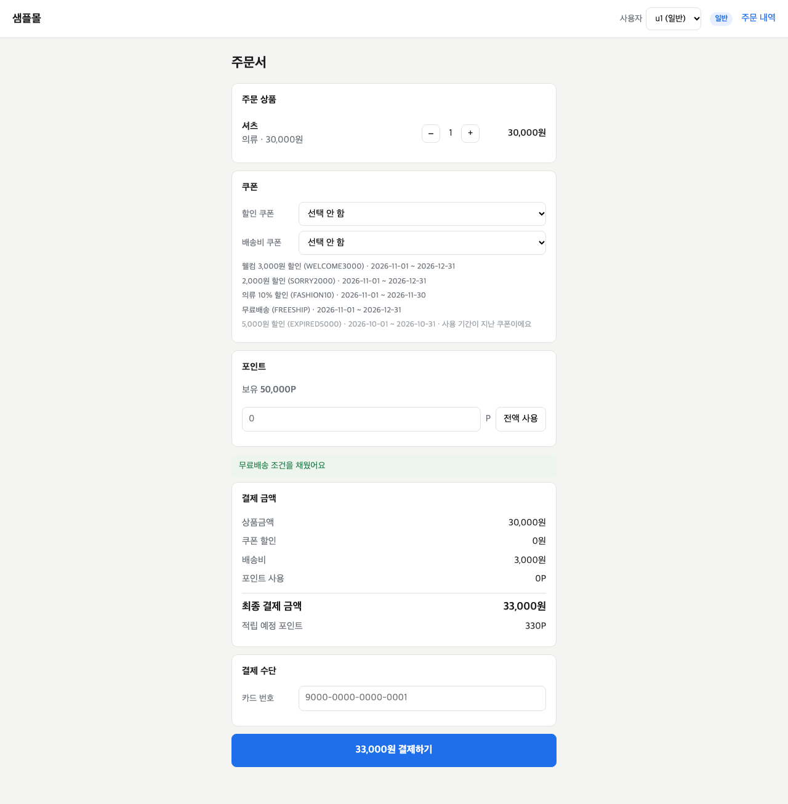
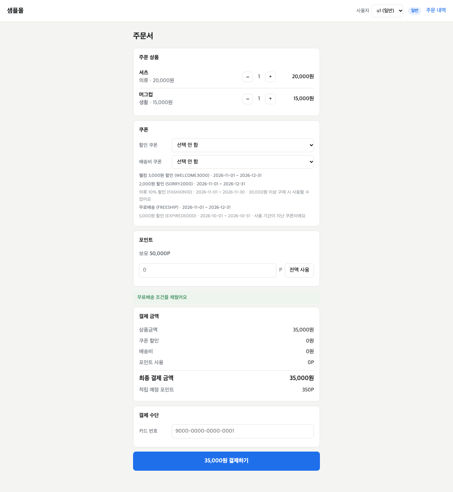

# 결함 리포트

조합 300개를 실행해 정책서와 다르게 나온 15개를 원인별로 묶은 결과입니다. 판정 기준은 샘플몰 주문서 결제 정책서 v1.0입니다.

| ID | 제목 | 심각도 | 걸린 조합 |
|---|---|---|---|
| DEF-01 | 할인 후 상품금액이 무료배송 기준과 같을 때 배송비가 부과됨 | 높음 | 11개 |
| DEF-02 | 다른 카테고리와 함께 담으면 '의류 10% 할인'을 고를 수 없음 | 중간 | 4개 |

- 발견: 2026-11-12, 자동화 실행 (`PriceCombinationUiTest`, 조합 300개)
- 환경: 로컬에 띄운 샘플몰, 크로미움, 서버 시각 2026-11-15 12:00 고정
- 대상의 소스 코드는 보지 않았습니다. 화면과 API 응답만으로 확인했습니다.

## DEF-01 할인 후 상품금액이 무료배송 기준과 같을 때 배송비가 부과됨

**심각도: 높음** — 고객이 3,000원을 더 냅니다. 화면의 안내 문구는 무료배송이라고 하는데 금액에는 배송비가 붙어 있습니다.

### 재현 절차

1. 사전 조건: 사용자 u1(일반), 장바구니 셔츠(의류) 30,000원 × 1, 쿠폰 선택 안 함
   - 셋팅: `mall reset && mall cart u1 셔츠 의류 30000 1`
2. 주문서를 연다.
3. '결제 금액' 상자를 확인한다.

### 기대 결과

배송비 0원 · 최종 결제 금액 30,000원

- 정책서 '회원 등급': 일반 등급 무료배송 기준은 할인 후 상품금액 30,000원 **이상**
- 정책서 '결제 금액 계산 규칙' 4번, 예시 C(할인 후 30,000원 → 배송비 0원)

### 실제 결과

배송비 3,000원 · 최종 결제 금액 33,000원. 같은 화면의 안내 문구는 "무료배송 조건을 채웠어요"입니다.

### 조건 좁히기

기준 금액과 정확히 같을 때만 생깁니다. 1원이라도 넘으면 정상입니다.

| 등급 | 상품금액 | 배송비 (화면) | 기대 |
|---|---|---|---|
| 일반 | 29,999원 | 3,000원 | 3,000원 |
| 일반 | 30,000원 | **3,000원** | 0원 |
| 일반 | 30,001원 | 0원 | 0원 |
| VIP | 19,999원 | 3,000원 | 3,000원 |
| VIP | 20,000원 | **3,000원** | 0원 |
| VIP | 20,001원 | 0원 | 0원 |

쿠폰을 써서 할인 후 금액이 기준과 같아지는 경우에도 똑같이 생깁니다. 예: 일반 등급, 33,333원에 '의류 10% 할인'(3,333원) → 할인 후 30,000원 → 배송비 3,000원. 정책서 예시 C와 같은 주문입니다.

### 걸린 조합 (11개)

M-061, M-078, M-087, M-099, M-131 (일반) · M-176, M-179, M-188, M-197, M-291, M-294 (VIP)

## DEF-02 다른 카테고리와 함께 담으면 '의류 10% 할인'을 고를 수 없음

**심각도: 중간** — 쓸 수 있는 쿠폰이 막혀서 고객이 할인을 받지 못합니다. 결제 자체는 됩니다.

### 재현 절차

1. 사전 조건: 사용자 u1(일반), 장바구니 셔츠(의류) 20,000원 × 1 + 머그컵(생활) 15,000원 × 1
   - 셋팅: `mall reset && mall cart u1 셔츠 의류 20000 1 머그컵 생활 15000 1`
2. 주문서를 연다.
3. '할인 쿠폰' 상자를 눌러 '의류 10% 할인'을 확인한다.

### 기대 결과

'의류 10% 할인'을 고를 수 있고, 고르면 쿠폰 할인 2,000원 · 배송비 0원 · 최종 결제 금액 33,000원

- 정책서 '쿠폰 정책': 최소 주문금액은 쿠폰 적용 전 **상품금액 합계**로 판단 (합계 35,000원 ≥ 30,000원)
- 정책서 '쿠폰 정책': 카테고리 한정 쿠폰은 해당 카테고리 상품금액에만 할인 (의류 20,000원의 10% = 2,000원)

### 실제 결과

'의류 10% 할인'이 회색으로 나와 고를 수 없습니다. 사유는 "30,000원 이상 구매 시 사용할 수 있어요"입니다. 상품금액은 35,000원입니다.

### 조건 좁히기

상품금액 합계가 아니라 의류 금액이 30,000원 이상인지로 갈립니다.

| 의류 | 생활 | 상품금액 합계 | '의류 10% 할인' (화면) | 기대 |
|---|---|---|---|---|
| 29,999원 | 20,000원 | 49,999원 | **고를 수 없음** | 고를 수 있음 |
| 30,000원 | 10,000원 | 40,000원 | 고를 수 있음 | 고를 수 있음 |
| 15,000원 | 15,000원 | 30,000원 | **고를 수 없음** | 고를 수 있음 |

최소 주문금액을 합계가 아닌 의류 금액으로 판단하는 것으로 보입니다. 의류만 담은 장바구니에서는 두 값이 같아서 드러나지 않습니다.

### 걸린 조합 (4개)

M-129, M-134 (일반) · M-279, M-284 (VIP)

## 결함으로 올리지 않은 것

- **쿠폰을 쓸 수 없는 사유가 둘일 때의 문구** — 생활 20,000원에 '의류 10% 할인'은 최소 주문금액 미달이면서 의류 상품도 없습니다. 어느 문구를 보여 줄지 정책서에 없어서 판정하지 않았습니다 (TC 문서 '정책 문의' PR-06).
- **적립 예정 포인트, 무료배송 안내 문구** — 정책서 두 곳의 기준이 서로 달라 정답을 정할 수 없습니다 (PR-01, PR-02). 자동 판정에서 뺐습니다.
